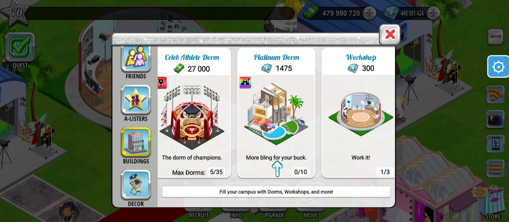
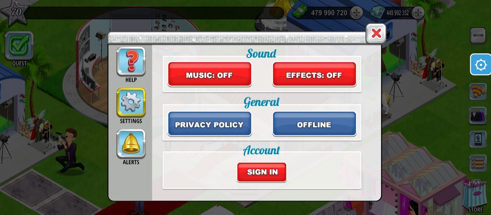
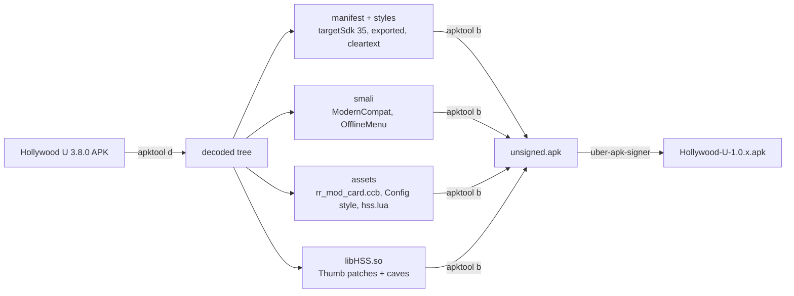

<div align="center">

# ⭐ Hollywood U · RR Mod

**Hollywood U: Rising Stars 3.8.0, playable again — offline, on current Android, with a fully unlocked store.**

[](https://github.com/RobyRew/hollywood-u-rising-stars/releases/latest)


[](LICENSE)


</div>

Pixelberry shut Hollywood U's servers and store listings on **10 August 2022**. The last client, 3.8.0 (2017), stops at an *Offline* wall, refuses to install on modern phones, and its store can no longer pay out. This repository rewrites that APK so it runs entirely on the phone.

> [!NOTE]
> Hollywood U, its art, scripts and native library are © Pixelberry Studios. The `decoded/` tree and the release APKs are the 3.8.0 client, published here so the game survives. The patcher code in `patcher/` is MIT.

---

## ✨ What you get

<table>
<tr>
<td width="50%" valign="top">

### 📱 Runs on today's phones
- `targetSdkVersion` **35** — installs on Android 14–17 without the "built for an older version" block
- `exported` flags, `PendingIntent` immutability and receiver export flags for Android 12+
- 32-bit libraries also packaged as `armeabi-v7a`
- Cleartext HTTP, legacy storage and `org.apache.http.legacy` kept for the 2017 libraries

</td>
<td width="50%" valign="top">

### 🔌 No servers, no account
- The dead server-time call uses the phone clock, so the *Offline* dialog never blocks
- Store, currency tab and clothing tab skip their "Network error" screens
- No Pixelberry account, no Google account, no signal needed to buy
- Crash-prone leftovers after a buy (sound JNI, analytics, LeanPlum, sale-date check, reward cinematic) are skipped

</td>
</tr>
<tr>
<td valign="top">

### 🛍️ Store that pays out
- Every pack, bundle, building, outfit and friend buys locally and grants **what its config says**
- *Unlocks with Quest …* cards are buyable — the quest itself still runs normally
- *Unlocks with Club VIP* friends are buyable; the Club VIP building stays a normal buy

</td>
<td valign="top">

### ⚙️ RR Mod settings
- **+10,000,000 cash**, **+10,000,000 diamonds**, **+5,000,000 XP**, or all three at once
- **Export / import** the real save (`files/`, `shared_prefs/`, `databases/`) as a `.hollywoodujson` file
- The first-run acceptance letter doesn't wait for a tap; the tutorial after it runs as usual
- Quests keep the game's own rules — nothing is marked complete for you

</td>
</tr>
</table>

<div align="center">


</div>

### 🆕 1.0.21 — a native RR MOD tab

The game's own Settings dialog (Help · Settings · Alerts) gets a fourth tab, **RR MOD**, with the settings gear icon. It is a real cocos card built in the game's `.ccb` format, styled like the Settings card, with three sections of native buttons:

| Section | Buttons |
| --- | --- |
| **Currency** | `+ CASH` (10,000,000) · `+ DIAMONDS` (10,000,000) · `+ XP` (5,000,000) |
| **Max Levels** | `FRIENDS` (every friend and A-lister to the top skill level) · `BUILDINGS` (every building to its top upgrade level) · `EVERYTHING` (all five) |
| **Save Data** | `EXPORT` · `IMPORT` · `MORE` (opens the full RR Mod panel) |

The blue floating gear and the **OFFLINE** button in Settings still open the same RR Mod panel.

---

## 📥 Install

1. Download `Hollywood-U_3.8.0_RR-Mod_1.0.x.apk` from [**Releases**](https://github.com/RobyRew/hollywood-u-rising-stars/releases/latest) and copy it to the phone.
2. Play Protect will say it doesn't know the developer — that's the mod's own signing key. Choose **Install anyway**.
3. Open the game. The campus and everything shipped inside the APK runs from the phone.

> [!IMPORTANT]
> **Moving from 1.0.20 to 1.0.21+:** 1.0.20 was signed with a different key, so Android won't update it in place. Before uninstalling, tap the blue gear → **Export progress**, then install the new build and **Import progress**. (Or with a computer: `adb backup -noapk com.pixelberrystudios.hwuandroid`, reinstall, `adb restore`.)

<details>
<summary><b>📵 Phones it can't run on</b></summary>

The client ships only 32-bit ARM code (`libHSS.so`). Phones that dropped 32-bit support — Samsung from the Galaxy S24 and A55, recent Pixels — report the app as incompatible, and no manifest change fixes that. Any phone or emulator that still runs 32-bit ARM can.

</details>

<details>
<summary><b>🧩 What isn't in 3.8.0</b></summary>

Content Pixelberry only delivered from the server is not in the APK, including the last stretch of the main quest. Outfit bundles are still defined and buyable; the patch doesn't invent missing quest files.

</details>

---

## 🛠️ Build it yourself



**Needs:** Python 3.9+, a JDK 17+ (`java` on `PATH`, `JAVA_HOME`, or `--java`). Apktool 3.0.3 and uber-apk-signer 1.3.0 are in `tools/` (licenses in `tools/THIRD_PARTY.txt`).

```bash
python3 patcher/patch_apk.py --apk "Hollywood+U-+Rising+Stars_3.8.0_APKPure.apk"
```

The result is `dist/Hollywood-U-1.0.x.apk` (releases rename it `Hollywood-U_3.8.0_RR-Mod_1.0.x.apk`). Releases stay on `1.0.x`; `VERSION_PATCH` in `patcher/patch_apk.py` is the only number to bump.

The first run creates `build/offline.keystore` and signs with it. **Keep that file** — a build signed with any other key can't update an installed copy.

| Option | Default |
| --- | --- |
| `--apk` | *(required)* the 3.8.0 APK, package `com.pixelberrystudios.hwuandroid` |
| `--out` | `dist/Hollywood-U-1.0.x.apk` |
| `--java` | `JAVA_HOME/bin/java`, then `java` on `PATH` |
| `--work` | `build/decoded` |

Every native patch checks the original bytes first, so any version other than 3.8.0 stops with an error instead of writing a broken library.

### GitHub Actions

| Workflow | Runs on | Does |
| --- | --- | --- |
| **Check patcher** | every push and PR | compiles the Python |
| **Build tweaked APK** | manual | downloads the APK attached to a release named `source-apk`, patches it, uploads the result as an artifact |

A CI runner has no `build/offline.keystore`, so each workflow build is signed with a fresh key and can't update a copy installed from a local build or a release.

---

## 🗂️ Repository map

```text
patcher/
├── patch_apk.py        decode → patch manifest, styles, smali, assets, lib → build → sign
├── hwu_native.py       libHSS.so byte patches (offline, store, gates, HUD, grants)
├── rr_tab.py           RR MOD tab: Settings-dialog hook, button actions, max-level loops
├── rr_card.py          builds rr_mod_card.ccb and its Config.protobin title style
├── thumb.py            small Thumb assembler used by rr_tab.py
├── ModernCompat.smali  PendingIntent / registerReceiver / notification shims
└── OfflineMenu*.smali  RR Mod panel, blue gear, export/import, nativeAction bridge
docs/REVERSE.md         how the store, quest card, HUD and grants were traced
decoded/                apktool tree of the 3.8.0 client
tools/                  apktool, uber-apk-signer, Frida hook list
```

How the store payout, quest card, HUD buttons and grant entry points were found is in [docs/REVERSE.md](docs/REVERSE.md).

---

## 🐞 Support

Open an [issue](https://github.com/RobyRew/hollywood-u-rising-stars/issues) with:

- phone model and Android version
- fresh install or update
- a screenshot of the dialog
- if you can, `adb logcat` from the moment it fails

<div align="center">
<sub>Patcher © RobyRew · MIT &nbsp;·&nbsp; Hollywood U © Pixelberry Studios, not licensed by this repository</sub>
</div>
